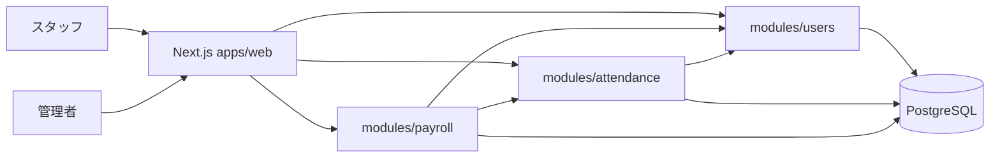

# TimeCard

**小規模店舗向けの勤怠管理 Web アプリケーション**です。スタッフの出退勤から、管理者による勤怠の訂正・取消、時給ルールの管理、給与見込みの確認までを一つのシステムで扱います。

店舗の勤怠業務を題材に、**要件整理・設計・実装・自動テスト・デプロイ／運用設計を個人で一貫して担当**しています。画面を作るだけでなく、後から勤務記録が修正される業務特性を踏まえ、変更履歴・整合性・保守性を重視しました。

> [!NOTE]
> 転職活動向けに切り出したコードのスナップショットです。実装は [`snapshot/`](./snapshot/) に格納しています。この README は設計上の判断やコードの見どころを短時間で確認できるように整理しています。

## 画面と操作動画

スクリーンショットと動画は、**テスト用の架空データ**を使用して生成した操作ガイド用メディアです。Neon の **Production ブランチ**にある公開読み取り用ストレージから表示しています。実際の従業員情報や勤怠データの画面ではありません。

### スタッフ向け画面

LINE Login / LIFF を利用した認証を入口に、勤務区分・出退勤時刻を入力し、自身の勤務状態や履歴を確認できます。

<table>
  <tr>
    <th align="center">出勤</th>
    <th align="center">退勤</th>
  </tr>
  <tr>
    <td align="center"><a href="https://br-floral-shadow-az1guvm8.storage.c-3.ap-southeast-1.aws.neon.tech/time-card-help/screenshots/staff-clock-in.png"></a></td>
    <td align="center"><a href="https://br-floral-shadow-az1guvm8.storage.c-3.ap-southeast-1.aws.neon.tech/time-card-help/screenshots/staff-clock-out.png"></a></td>
  </tr>
</table>

**操作動画：** [出勤する](https://br-floral-shadow-az1guvm8.storage.c-3.ap-southeast-1.aws.neon.tech/time-card-help/videos/clock-in.mp4) / [退勤する](https://br-floral-shadow-az1guvm8.storage.c-3.ap-southeast-1.aws.neon.tech/time-card-help/videos/clock-out.mp4)　｜　[勤務履歴の画面](https://br-floral-shadow-az1guvm8.storage.c-3.ap-southeast-1.aws.neon.tech/time-card-help/screenshots/staff-history.png)

### 管理者向け画面

勤怠の検索・確認、訂正・取消、変更履歴の追跡、時給履歴の管理、給与見込みの確認に対応しています。

**勤怠一覧**

[](https://br-floral-shadow-az1guvm8.storage.c-3.ap-southeast-1.aws.neon.tech/time-card-help/screenshots/admin-attendance-list.png)

<table>
  <tr>
    <th align="center">勤怠詳細・変更履歴</th>
    <th align="center">時給設定</th>
  </tr>
  <tr>
    <td align="center"><a href="https://br-floral-shadow-az1guvm8.storage.c-3.ap-southeast-1.aws.neon.tech/time-card-help/screenshots/admin-attendance-detail.png"></a></td>
    <td align="center"><a href="https://br-floral-shadow-az1guvm8.storage.c-3.ap-southeast-1.aws.neon.tech/time-card-help/screenshots/admin-hourly-wages.png"></a></td>
  </tr>
</table>

**給与見込み**

[](https://br-floral-shadow-az1guvm8.storage.c-3.ap-southeast-1.aws.neon.tech/time-card-help/screenshots/admin-payroll-estimate-list.png)

**操作動画：** [勤怠を訂正する](https://br-floral-shadow-az1guvm8.storage.c-3.ap-southeast-1.aws.neon.tech/time-card-help/videos/attendance-correction.mp4) / [時給ルールを一括変更する](https://br-floral-shadow-az1guvm8.storage.c-3.ap-southeast-1.aws.neon.tech/time-card-help/videos/hourly-wage-rule-bulk-edit.mp4)

## 主な機能

- **スタッフ**：LINE Login / LIFF 認証、出退勤、勤務状態・勤怠履歴の確認
- **勤怠管理**：管理者による勤怠の新規作成・訂正・取消、操作者を含む変更履歴の保持
- **時給管理**：曜日・祝日・昼夜区分に応じた時給と、適用開始日を持つ時給履歴
- **給与見込み**：勤怠と適用時給に基づく月次集計
- **ユーザー管理**：利用承認・停止、表示名変更、管理者／スタッフの権限分離

## 設計・実装で見てほしいポイント

### 1. 業務境界を中心に分割した Modular Monolith

単一の Next.js アプリケーションと PostgreSQL を維持しながら、**Users / Attendance / Payroll** を業務単位のモジュールに分けています。各モジュールに Domain・Application・Infrastructure を置き、Web の都合や DB 実装が業務ルールへ直接入り込まないようにしました。

- [ユーザー・認証](./snapshot/modules/users/) / [勤怠](./snapshot/modules/attendance/) / [時給・給与見込み](./snapshot/modules/payroll/)
- [システム設計書](./snapshot/docs/設計書.md)

### 2. 勤怠に限定した Event Sourcing と同期 Projection

勤怠の出勤・退勤・訂正・取消は **Event Stream を原本**として記録し、通常の一覧・集計には Current State Projection を使用します。イベント追記と Projection 更新を同一 PostgreSQL トランザクションで確定し、変更履歴を保持しながら現在状態を効率よく参照できるようにしています。

この方式はシステム全体に機械的に適用していません。**CRUD ＋監査ログ**や**非同期 Projection**も比較したうえで、勤怠に必要な履歴・再構築性と整合性のバランスから選択しています。

- [設計判断記録（ADR 0001）](./snapshot/docs/adr/0001-attendance-event-sourcing-and-projection.md)
- [Attendance の Domain](./snapshot/modules/attendance/src/domain/attendance.ts)
- [Event Stream の再生処理](./snapshot/modules/attendance/src/application/attendance-replay.ts)

### 3. UI だけに依存しない整合性と認可

出退勤の状態遷移、勤務時間の重複、時刻の整合性、取り消し後の操作、権限の違いを **Domain・Application・DB** の適切な境界で保証しています。同じ勤怠への同時変更は event version で検出し、古い画面の内容で上書きしない設計です。

- [勤怠の状態遷移](./snapshot/modules/attendance/src/domain/attendance.ts)
- [勤務時間の重複検証](./snapshot/modules/attendance/src/domain/attendance-overlap.ts)
- [設計書：認証・認可と勤怠](./snapshot/docs/設計書.md)

### 4. 時給ルールを独立した業務ロジックとして実装

曜日・祝日・昼夜区分・適用開始日という複数の条件から時給を決定します。金額計算や月次集約を UI から分離し、変更しやすくテストできる形にしています。

- [時給ルール](./snapshot/modules/payroll/src/domain/hourly-wage-rule.ts)
- [給与見込み](./snapshot/modules/payroll/src/application/payroll-estimate.ts)
- [月次集約](./snapshot/modules/payroll/src/application/monthly-payroll-estimate.ts)

### 5. リスクに応じてテストを使い分ける

テストはツール名ではなく、必要な実行資源に応じて **Small / Medium** に分けています。

| 分類 | 主な検証対象 |
| --- | --- |
| Small | 業務ルール、状態遷移、Application、UI の振る舞い |
| Medium | PostgreSQL の制約・トランザクション、実ブラウザによる主要フロー、アクセシビリティ |
| 補助的な確認 | Storybook によるコンポーネントの状態別確認、Property-based Test |

Vitest、Node.js Test Runner、Playwright、Testcontainers、axe などを用途に応じて使用しています。静的解析・型チェック・ビルド・テストをまとめた品質確認の入口は `pnpm quality` です。

- [テスト方針を含む開発標準](./snapshot/docs/開発標準.md)
- [品質確認スクリプト](./snapshot/scripts/quality/run-quality.mjs)
- [Web アプリのテスト・ビルド設定](./snapshot/apps/web/package.json)

### 6. 継続開発を見据えた開発・運用基盤

pnpm workspace / Turborepo によるモノレポ管理、Biome 等による静的検証、Sentry によるエラー監視、GitHub Actions による品質確認・デプロイ・DB バックアップの構成も用意しています。AI エージェントを開発に利用するため、編集ルールやテストなどのガードレールもコードと一緒に管理しています。

- [開発ルール](./snapshot/CONTRIBUTING.md)
- [CI・デプロイ定義](./snapshot/.github/workflows/)
- [環境構築・デプロイ手順書](./snapshot/docs/環境構築・デプロイ手順書.md)

## 技術スタック

| 分野 | 技術 |
| --- | --- |
| フロントエンド・サーバー | Next.js 16（App Router）、React 19、TypeScript、Server Components / Server Actions |
| データベース | PostgreSQL 18（Neon）、Drizzle ORM |
| 認証 | LINE Login / LIFF、サーバー側セッション管理 |
| モノレポ | pnpm workspace、Turborepo |
| テスト | Vitest、Node.js Test Runner、Playwright、Testcontainers、fast-check |
| UI・品質 | Storybook、axe、Biome、ESLint、TypeScript、Knip |
| 運用 | Vercel、Sentry、GitHub Actions、DB バックアップ |

## アーキテクチャの概要



モジュール内で Domain / Application / Infrastructure の責務を分け、`apps/web` が画面・Server Actions・依存関係の組み立てを担当します。詳細は [設計書](./snapshot/docs/設計書.md) を参照してください。

## ソースコードの場所と動かし方

ソースコード本体は [`snapshot/`](./snapshot/) 以下です。

| ディレクトリ | 内容 |
| --- | --- |
| [`snapshot/apps/web/`](./snapshot/apps/web/) | スタッフ・管理画面、Next.js の UI / Server Actions |
| [`snapshot/apps/help/`](./snapshot/apps/help/) | 利用者向け操作ガイド |
| [`snapshot/modules/`](./snapshot/modules/) | 認証・勤怠・給与の業務モジュール |
| [`snapshot/packages/`](./snapshot/packages/) | DB、PostgreSQL 接続基盤、共通 UI・contracts |
| [`snapshot/tools/`](./snapshot/tools/) | メディア生成や保守・テスト補助ツール |
| [`snapshot/docs/`](./snapshot/docs/) | 要件定義・設計・ADR・開発標準 |

Node.js 24.x、pnpm 12.12.0 を使用します。リポジトリ直下ではなく `snapshot/` 内で実行してください。

```bash
cd snapshot
pnpm install --frozen-lockfile
pnpm dev:web
```

総合品質確認は `pnpm quality` で実行できます。Medium Test では Docker や実ブラウザ等の追加実行環境が必要です。実 LINE / LIFF 認証を利用する場合は別途環境設定が必要です。

## スナップショットについて

- **対象コード**：TimeCard 2.0.0-rc.5 時点のスナップショット
- **元の revision**：`6a20453d21c3bdedbdd25f06c321fc0fc23c462d`（2026-10-12 時点の `develop`）
- **更新方針**：転職活動用に固定時点の成果物を公開するもので、実開発リポジトリとの継続同期は前提にしていません。
- **メディア**：Neon Production ブランチの公開読み取り可能な `time-card-help` バケットを参照します。アプリの実運用データではなく、操作ガイド用の架空データを使った画像・動画です。

実際の要求・内部設計については [要件定義書](./snapshot/docs/要件定義書.md)、[設計書](./snapshot/docs/設計書.md)、[ADR](./snapshot/docs/adr/) にまとめています。
